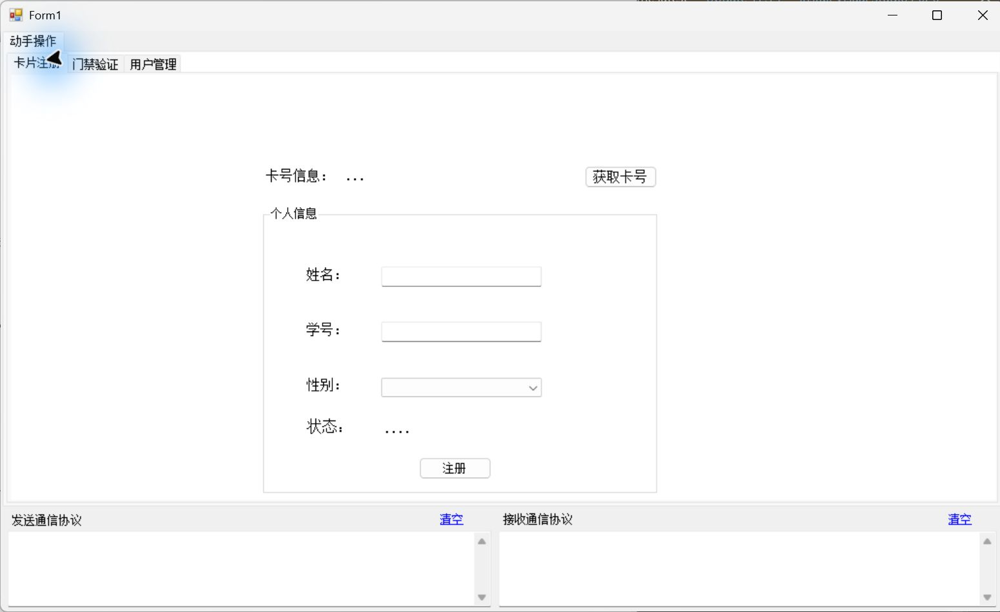
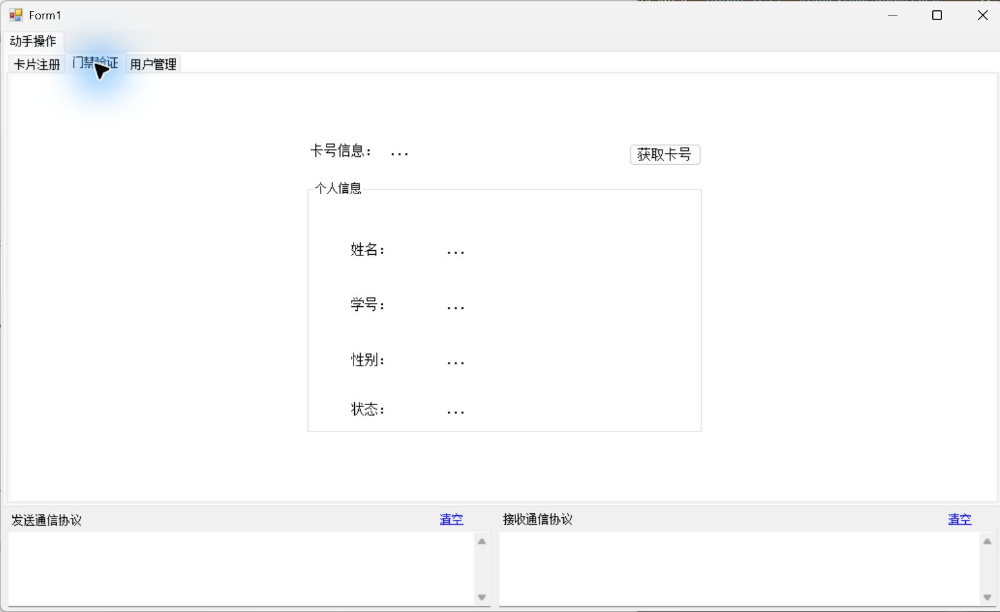
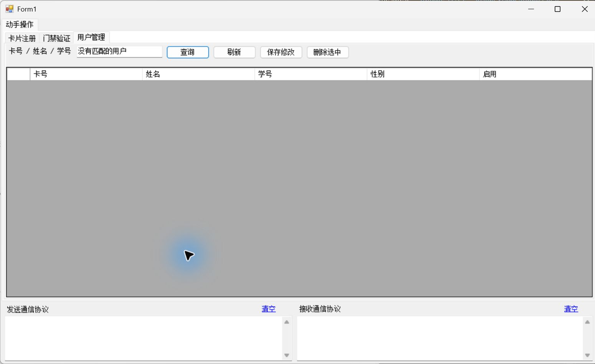

# 125GateApp：低频 RFID 门禁实验

基于 C# Windows Forms 的低频 RFID 门禁实验程序。项目在课程提供的 125GateApp 示例上进行调整，用于学习串口通信、卡号读取、用户登记与门禁验证。

## 目录

- [功能](#功能)
- [界面截图](#界面截图)
- [软件环境](#软件环境)
- [硬件设备](#硬件设备)
- [项目结构](#项目结构)
- [运行与实验](#运行与实验)
- [数据与注意事项](#数据与注意事项)

## 功能

程序设计包含以下四个功能页面：

1. **设备连接**：选择串口，以 57600 波特率连接设备（当前运行界面尚未显示，待排查）。
2. **卡片注册**：获取卡号，登记姓名、学号和性别。
3. **门禁验证**：读取卡号，检查用户是否存在且启用，并按实验程序控制开门或报警。
4. **用户管理**：查询、修改、启用或禁用、删除已登记用户。

界面保留发送与接收通信数据的显示区域。代码已进行编译检查；新增功能和硬件联动仍需在实际实验中验证。

## 界面截图

以下为当前运行窗口中显示的三个页面；用户管理页已通过筛选隐藏数据。设备连接页尚未在运行界面中显示，需要进一步排查。

### 卡片注册



### 门禁验证



### 用户管理



## 软件环境

- Windows、Visual Studio 2022。
- C#、Windows Forms、.NET Framework 4.8。课程原始项目使用 4.0，实验副本已调整为 4.8。
- F-TABLE 上位机和配套通信组件；课程资料包含 USB 转串口驱动，是否需要安装及具体类型取决于连接设备。
- 项目引用 `Interfaces.dll`、`IrisSkin4.dll` 和 `Newtonsoft.Json.dll`；当前项目配置中的引用指向本机 F-TABLE 目录 `D:\FTableExp\FTableExp\bin`。其他电脑需要准备兼容的依赖并调整引用。

## 硬件设备

- **125 kHz 低频 RFID 读写器**及配套实验设备：用于读取低频卡；具体型号待补充。
- **EM4100 低频实验卡**：课件采用此类卡；实际使用的卡片型号待确认。
- **USB 转串口连接线及电源**：用于连接电脑与实验设备，具体接口和供电方式以实验设备为准。
- **步进电机与声光报警器**：课程示例用它们模拟开门和报警；实际实验箱配置及接线待确认。

## 项目结构

```text
03_RFID_E/
├── 125GateApp/       # 低频门禁程序及解决方案
└── README.md
```

## 运行与实验

1. 使用 Visual Studio 打开 `125GateApp/125GateApp.sln`，检查项目依赖后生成并运行。
2. 连接实验设备并按要求供电，在设备管理器中确认串口编号。
3. 在程序的设备连接页选择串口并连接，波特率为 57600。若 F-TABLE 占用同一串口，先释放该串口。
4. 用实验卡在卡片注册页获取卡号、填写信息并注册，再切换到门禁验证页测试。

串口能打开不代表读卡和硬件联动已验证；设备配置、卡号读取及执行结果应以实际测试为准。

## 数据与注意事项

- 用户登记数据保存在程序运行目录的 `plugin/125GateApp/db.json`，可能包含姓名和学号等个人信息，应仅用于实验并注意保护。
- 用户管理修改或删除记录时会生成 `db.json.bak` 备份。
- `bin/`、`obj/` 和 `.vs/` 等生成或本机文件由 Git 忽略。
- 当前引用存在本机路径依赖，仓库尚不能保证在其他电脑直接编译；硬件设备与功能还需要实际验证。
